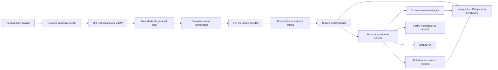

# Architecture

Training and inference consume local model files; loading uses `local_files_only=True`. The application service keeps retrieved source excerpts and citations, deterministic calculation outputs and assumptions, and model-generated explanations in separate fields. Retrieval is a small local TF-IDF search over dated curated excerpts and source-specific query anchors; it is not live browsing and can return no source or stale material. The audit found the strict matcher returned only 2/110 benchmark prompts, both partially supported, so it has low recall and does not provide complete coverage. The calculator supports named arithmetic functions only and does not determine legal, tax, investment, or insurance applicability. The API does not include authentication or persistence and should remain on loopback. Generated answers are not independently validated by a fact-checking service.
